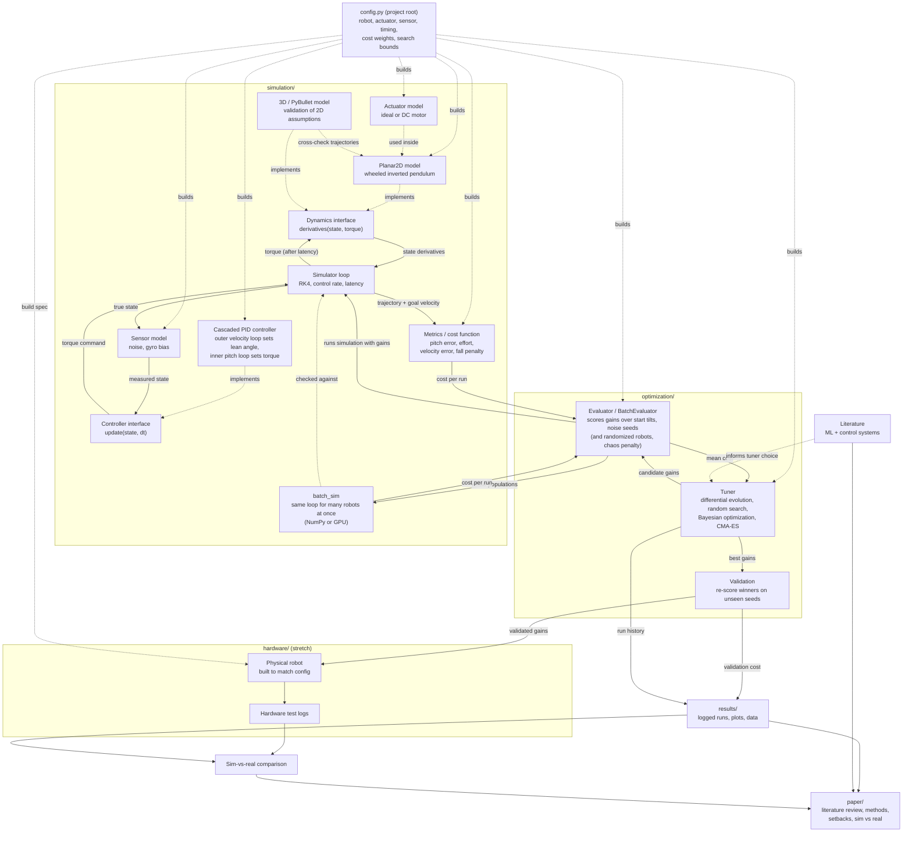

# Project Architecture: ML-Tuned Control of a Two-Wheeled Balancing Robot

Living document. Updated as components are designed and built.
Last updated: 2026-09-28

See also:
- `README.md` — the folder layout, and the exact order everything runs in.
- `config.py` (project root) — the single place to edit the robot, actuator model, sensor noise, delays, cost weights, search ranges, and the batched tuner's robustness test.
- `simulation/CONDITIONS.md` — the running list of real-world effects the simulation includes.
- `BATCHED.md` — the batched (NumPy/GPU) engine: design, verification, speed.
- `PHYSICS.md` — derivation of every equation in the simulator, checked numerically by `simulation/examples/physics_checks.py`, with limitations and next steps.
- `DATASHEET.md` — realistic values for every physical constant, from a reference build of real parts (motors, wheels, driver, battery, IMU, servo), compared against `config.py`; derived numbers from `simulation/examples/datasheet_numbers.py`.
- `archive/CHANGES_FROM_ORIGINAL.md` — what was corrected from the first version of the code.

## Status legend

- **Planned**: designed on paper, no code yet
- **In progress**: code being written
- **Built**: working and tested
- **Stretch**: may not fit within the course timeline

## System flowchart

## Component status

| Component | Location | Status |
|---|---|---|
| Project configuration (single source of truth) | config.py | Built |
| Robot config (parameters) | simulation/balance_sim/params.py | Built |
| Dynamics interface | simulation/balance_sim/dynamics.py | Built |
| Planar2D model | simulation/balance_sim/planar2d.py | Built |
| Actuator model (ideal, DC motor) | simulation/balance_sim/actuators.py | Built |
| Sensor model (noise, gyro bias) | simulation/balance_sim/sensors.py | Built |
| 3D / PyBullet validation model | simulation/ | Planned |
| Controller interface | simulation/balance_sim/controllers.py | Built |
| Pitch PID controller | simulation/balance_sim/controllers.py | Built |
| Cascaded velocity + pitch controller | simulation/balance_sim/controllers.py | Built (P outer loop: kv_i dropped after it always tuned to 0; no position hold yet) |
| Goal velocity profiles | simulation/balance_sim/controllers.py | Built (constant, step profile) |
| LQR controller (delay-aware design on the linearized robot) | simulation/balance_sim/lqr.py, planar2d.py (`linearize`) | Built (reference and batched, NumPy + GPU; see LQR.md) |
| Linear loop stability and delay margins, either controller | simulation/balance_sim/stability.py | Built (reproduces PHYSICS.md 7.4) |
| Simulator loop | simulation/balance_sim/simulator.py | Built (RK4, control-rate hold, latency, sensor hookup, goal recording) |
| Metrics / cost function | simulation/balance_sim/metrics.py | Built (weights now set via config.py) |
| Batched simulator (NumPy + PyTorch/CUDA graphs) | simulation/batch_sim/ | Built (bit-identical to the reference in float64 on NumPy) |
| Simulation tests | simulation/tests/ | Built (reference + batched) |
| Conditions list | simulation/CONDITIONS.md | Living document |
| Search space (gain bounds, log scaling) | optimization/tuning/search_space.py | Built |
| Evaluator (multi-scenario scoring) | optimization/tuning/evaluation.py | Built |
| Tuner: differential evolution | optimization/tuning/optimizers.py | Built |
| Tuner: random-search baseline | optimization/tuning/optimizers.py | Built |
| Tuner: Bayesian optimization | optimization/tuning/optimizers.py | Built (needs `pip install scikit-optimize`) |
| Result logging (JSON, CSV, plots) | optimization/tuning/reporting.py, run_tuning.py, run_batch_tuning.py | Built |
| Batched tuner: evaluator, vectorized DE, random search, CMA-ES | optimization/batch_tuning/, run_batch_tuning.py | Built |
| Robust scoring: 50 seeds, randomized robots, chaos penalty | optimization/batch_tuning/robust.py, config.py (`RobustnessSettings`) | Built |
| Benchmarks | optimization/benchmark.py, benchmark_batch.py | Built |
| Tuner + config tests | optimization/tests/ | Built (301 tests in total with simulation/tests) |
| Config snapshot saved with every run | config.py (`snapshot()`), both run scripts | Built |
| LQR tuning: weights, or gains directly (kept nominally stable) | optimization/tuning/search_space.py, config.py (`LQRConfig`) | Built |
| PID vs LQR comparison (hand-designed and ML-tuned, latency sweep) | optimization/run_lqr_comparison.py, LQR.md | Built |
| Reinforcement learning | optimization/ | Planned |
| Literature review | literature/, paper/ | Planned |
| Physical robot | hardware/ | Stretch |
| Sim-vs-real comparison | results/, paper/ | Stretch |

## How the pieces work together

(`README.md` has the step-by-step version, including the batched engine.)

1. **`config.py`** at the project root holds every adjustable number: the robot's physical parameters, which actuator model to use, sensor noise, latency and timing, the controller's lean-angle cap and hand-tuned baseline gains, the cost function's weights, the tuner's test scenario (goal velocity profile, start tilts, noise seeds), and the search bounds for each gain. It builds the real objects (`RobotParams`, `Planar2D`, `EvalConfig`, `SearchSpace`, ...) that the rest of the code uses, so a single edit here reaches the simulation, the demos, and the tuner together.
2. The **simulator loop** advances the model in time. At each control tick, the **sensor model** turns the true state into a noisy measurement, the controller turns that into a torque command, and the command reaches the actuator after the configured latency.
3. The **cascaded controller** compares measured velocity to the **goal velocity**. The outer loop turns that error into a lean angle, and the inner pitch loop turns the lean-angle error into torque.
4. The **actuator model** converts the command into applied torque (ideal, or limited by back-EMF, supply voltage, and current). The dynamics model returns how the state changes.
5. **Metrics** turn a finished trajectory into a score: pitch error, control effort, velocity error against the goal, and a penalty for falling.
6. The **evaluator** takes a set of gains, runs several scenarios (different start tilts and noise seeds), and returns the mean cost.
7. The **tuner** proposes gains, reads the evaluator's score, and iterates. Differential evolution and Bayesian optimization are both available; random search is the baseline either has to beat.
8. The winning gains are re-scored on noise seeds the search never saw (**validation**) to check for overfitting. Runs are logged to **results/** and feed the **paper**, alongside the literature review.
9. If the hardware phase happens, the validated gains are loaded onto the **physical robot**, and the gap between simulated and measured behavior becomes a central result of the paper.

## Change log

- 2026-09-18: Initial version. All components planned.
- 2026-09-18: Simulation core built and tested (params, dynamics interface, Planar2D, PID, simulator loop, metrics). Added Planar2D.critical_pitch_gain(), the analytic lower bound on Kp, for use as a tuner search bound.
- 2026-09-18: Added sensor noise, control latency, and a DC motor model. Added CONDITIONS.md to track real-world effects. Tests now 25.
- 2026-09-19: Added cascaded velocity/pitch controller, goal velocity profiles, and a velocity error term in the cost function. Tests now 38.
- 2026-09-21: Built the first tuner (optimization/tuning): search space, multi-scenario evaluator, differential evolution, random-search baseline, validation on unseen seeds, and result logging. Sped up the simulation core about 2.5x (plain-float math in the hot path) so tuning runs finish in minutes. Tuner tests: 14.
- 2026-09-24: Added config.py at the project root as the single source of truth for physical parameters, actuator model, sensor noise, timing, cost weights, and search bounds; the demos and the tuner now all build from it instead of each holding their own copies of these values (this fixed a couple of small inconsistencies, like two different demo scripts using two different latency values). Added Bayesian optimization (scikit-optimize) as a second search method alongside differential evolution. Tuner + config tests: 23.
- 2026-09-28: Every tuning run now records a full snapshot of config.py (all robot parameters, actuator and sensor settings, timing, limits, cost weights, scenario, search bounds, plus derived values) in comparison.json and in each method's own result file, along with the run arguments and a timestamp. Tests: 25.
- 2026-09-28: Created CPU/, a corrected copy of simulation/, optimization/, and config.py that serves as the reference for the GPU rewrite (originals untouched; details in CPU/README.md). Fixes: the DC motor now respects max_torque; both controller loops have anti-windup; the cost's pitch term is measured against the commanded lean (switchable back to upright); every start tilt is tried with every seed (9 training runs, 30 validation); run_tuning.py adds an equal-budget comparison and bound warnings for every method; one requirements.txt; added optimization/benchmark.py. Tests: 86.
- 2026-09-28: Built the batched engine (then GPU/): batch_sim steps many robots at once with NumPy or PyTorch on the GPU (CUDA graphs), matching the reference simulator exactly in float64 on NumPy; batch_tuning adds a batched evaluator, vectorized differential evolution, and CMA-ES; robust scoring adds 50 seeds, randomized robots, and a chaos penalty. Up to about 5,800x faster per simulation than the reference on the GPU.
- 2026-09-28: Cleanup. The corrected code (CPU/) is now the project's only simulation/, optimization/ and config.py, with the batched engine alongside it (simulation/batch_sim, optimization/batch_tuning, run_batch_tuning.py, benchmark_batch.py). The robustness settings moved into config.py. One pytest.ini, one requirements.txt, one results/ (tuning/, batch_tuning/, benchmarks/). The original code and its results moved to archive/original/. Added README.md describing the run order. Tests: 153.
- 2026-09-28: Every project value now lives only in config.py: RobotParams, MotorParams, EvalConfig, SimSpec, BatchRobot, cost() and the search space lost their duplicate defaults, SensorNoise.typical() was removed, and the controllers' integral limits (previously hardcoded in two places) moved into ControllerConfig. The tests build from CONFIG. Dropped kv_i: the project's gain set is [kp, ki, kd, kv_p] (the controllers and both simulators still accept a fifth gain). The two tuning scripts share their results table, bound check and summary figure (tuning/reporting.py, SearchSpace.at_bounds), and the batched evaluator's noise_for / simulations_per_evaluation are public. The hand-tuned baseline without kv_i scores 0.243 (reference validation) instead of 0.277; the tuned optimum is unchanged at 0.108. Tests: 166.
- 2026-09-30: Added simulation/animate.py, an optional viewer: an animated side view of one or more runs (wheel, body, center of mass, commanded lean) with pitch / velocity / torque plots, saved as GIF or MP4 if wanted. Runs are simulated with the reference simulator first and then played back, or replayed from trajectory CSVs (balance_sim.save_trajectory / load_trajectory). Both tuning scripts now save their example runs to <results>/trajectories/. Tests: 172.
- 2026-10-14: Added an LQR controller to the base robot (simulation/balance_sim/lqr.py): full-state feedback designed on the linearized model (`Planar2D.linearize`), discretized at the control rate with the latency built in exactly (the commands in flight become part of the state). It runs in the reference simulator and in batch_sim (NumPy and GPU, bit-identical to the reference in float64 on NumPy). `balance_sim/stability.py` gives the exact stability of the sampled, delayed linear loop for either controller, and so every controller's delay margin. The tuners can search LQR weights or LQR gains (`LQRConfig` in config.py; `BatchEvaluator(controller="lqr", to_gains=...)`), and `optimization/run_lqr_comparison.py` compares hand-tuned and ML-tuned PID with four LQR variants on one common score. Design, results and findings: LQR.md. Tests: 262.
- 2026-10-24: The cost weights are now derived by Bryson's rule from three acceptable-value limits in `CostConfig` (`pitch_limit_rad` 0.3, `velocity_limit` 0.2 m/s, `torque_limit` 0.1 N m), giving velocity 2.25 and effort 9 (were 1 and 0.01). The cost now scores pitch from upright by default (was the commanded lean), and `fall_penalty` is 500 (was 100): at the new weights a slow, wandering controller that never falls can cost ~190, which beat the cheapest fall. The pivot side project keeps the old cost (`PIVOT_BASE_COST` in `pivot_config.py`). The weights are properties of `CostConfig` and the snapshot records both limits and weights. `physics_checks.py` follows `pitch_reference`. Tests: 268 (four LQR/pivot/torch/config tests changed or added; a test already failing before the change was fixed). Existing results in `results/` and the numbers in PHYSICS.md 8.2, LQR.md and BATCHED.md's cost figures were produced with the old cost and are not comparable; a re-run is pending.
- 2026-10-24 (later): `kv_p_max` raised from 0.4 to 0.8, which the tuned results had all sat on. Re-ran `run_batch_tuning.py` (`results/batch_tuning/20261024-133625`: CMA-ES 0.1305 robust validation cost, kv_p 0.800) and `run_lqr_comparison.py` (`results/lqr_comparison/20261024-135209`; the ML-tuned LQR gains are within 2.6% of the ML-tuned PID, and the untuned cost-matched LQR is 3x worse). A run with the bound at 2.0 (`results/batch_tuning/20261024-135453`) put kv_p at 0.82 for the same cost, so 0.8 stays. Two of the LQR searches ended at their range edges; see LQR.md. The pivot's search space reads the same bound, so its recorded results are unchanged but a re-run would differ.
- 2026-10-24 (later still): `kv_p_max` set to 0.9 so the settled value (about 0.82) is inside the bound. Widened the LQR search ranges (`w_velocity` floor 1e-2 to 1e-4, `w_integral` ceiling 10 to 1e3, `direct_gain_scale` 20 to 100) and re-ran `run_lqr_comparison.py` (`results/lqr_comparison/20261024-140819`): the tuned PID 0.1304, the tuned LQR gains 0.1334 (2.3% behind), the tuned LQR weights 0.1857. The LQR weight search now ends in a corner (floor for `w_velocity`, ceiling for `w_torque`) and the gain search keeps the command-feedback scales at their floor, which looks like a limit of those parameterizations rather than of the ranges (LQR.md).
- 2026-10-24 (last): the LQR pitch-rate weight and the gains on the commands in flight are held at off instead of searched (`LQRConfig.w_pitch_rate_fixed`, `direct_commands_scale`; `None` searches them as before; `lqr_weight_space`, `lqr_weights`, `LQRWeightDesigner`, `lqr_gain_space` and `LQRGainScaling` take the matching `fixed` / `commands_scale` arguments). Both searches had been driving them to the floor of their log ranges. Re-ran `run_lqr_comparison.py` (`results/lqr_comparison/20261024-142418`): the tuned LQR gains 0.1333 (unchanged, now with interior scales), the tuned LQR weights 0.1857 (unchanged, still in a corner at `w_velocity` and `w_torque`). Tests: 271.
- 2026-11-06: friction and latency randomization (PHYSICS.md 10.1). Both engines model viscous plus smoothed Coulomb friction (`RobotConfig.coulomb_friction`, `coulomb_friction_speed`). Per-simulation latency: `simulate_batch(delay_steps=...)` and `TorchSimulator(max_delay_steps=...)`. `RobustnessSettings.randomize_range` and `latency_range_s` draw friction and a 5-20 ms latency per scenario. The LQR weight search is torque-normalized, with the pitch, velocity and pitch-rate weights held at 0 (the corner was the pitch-weight normalization; LQR.md). The pivot uses config.py's cost (`PIVOT_BASE_COST` removed).
  - Guards: `control_dt` must be a whole multiple of `dt`; train and validation seeds may not overlap; results JSONs record git commit and library versions (`tuning.provenance`); a test checks the fall-penalty headroom.
  - Re-runs: `results/lqr_comparison/20261106-154350` (tuned PID 0.169, tuned LQR gains 0.199, tuned weights 0.241), `results/batch_tuning/20261106-154750` (same PID gains), `results/pivot_tuning/20261106-154343`.
  - Tests: 297.
- 2026-11-06 (later): `physics_checks.py`'s `TUNED` is now the 2026-11-06 set (`TUNED_0930` keeps the old one for 8.2 and 9.4), and PHYSICS.md quotes it throughout. The search's Kp floor comes from the most demanding randomized robot (`ProjectConfig.kp_floor_robot`; 0.300 instead of 0.253, still far below the tuned 0.66, so the recorded results stand). The batched engines apply the gyro bias without a noise table, as `SensorNoise` does with every std at 0. Tests: 301.
- 2026-11-08: Realistic physical constants (DATASHEET.md: a reference build of real parts, compared constant by constant). Both engines and the pivot model now include the motor rotors' reflected inertia in the mass matrix (`RobotParams.rotor_inertia`, PHYSICS.md 10.3), a gearbox efficiency in the DC motor model (`MotorParams.gear_efficiency`) and a constant pitch-estimate offset (`SensorNoise.pitch_bias`). config.py takes the Pololu 25D HP 6V 20.4:1 motor's constants (k_t 0.0053, 1.25 ohm with the driver, 7.6 V, efficiency 0.78), the real wheels (0.034 kg, 2.2e-5 kg m^2), body inertia 0.0065, max torque 0.34 N m, and friction ranges from the free-run current. With all of these off the code reproduces the previous results exactly (physics_checks.py output unchanged). The 2026-11-06 tuned gains are not tuned for this robot (validation cost 0.14 before, about 55 with 1 of 30 falls now); every results/ run predates it. PHYSICS.md's numbers and physics_checks.py stay on the earlier robot until regenerated after retuning.
- 2026-11-08 (later): Retuned on the datasheet robot (GPU, same arguments as 2026-11-06). `results/batch_tuning/20261108-132528`: CMA-ES and DE agree on kp 1.567, ki 2.101, kd 0.285, kv_p 0.645 (nominal validation 0.255, robust validation 0.583, no falls in 300 unseen robots, stable to 40.5 ms). `results/lqr_comparison/20261108-133118`: the PID still wins; tuned LQR gains 1.18x, tuned weights 1.39x, cost-matched LQR 3.7x. `results/pivot_tuning/20261108-132603`: same findings as before (the pivot still doesn't pay). physics_checks.py now runs on the current robot with rotor inertia and gear efficiency in its closed forms, and PHYSICS.md is regenerated from it (rotor inertia derived in 2.2; unstable pole 8.44 rad/s; the 2026-11-06 gains are linearly unstable here at any latency; a voltage-mode driver capped at the torque limit uses only 2.5 V of 7.6 V and every gain set falls). LQR.md and PIVOT.md quote the re-runs. Tests: 310.
- 2026-11-08 (scenario redesign): The test scenario is redesigned so every element is tied to a test objective and sized from a robot limit (`ScenarioConfig` docstring): start tilts 0.05, -0.15 and 0.30 rad, a 1.6 s speed-up to a 1.3 m/s cruise, forward and backward 2.9 N x 50 ms pushes at the body's center of mass, braking and reversing to -0.5 m/s, a stop; 20 s training runs and 60 s validation runs (the last goal held, so slow instabilities show). Both engines take an external force (`Planar2D.derivatives(..., force)`, `SimSpec.disturbance`); `step_profile` takes a blend time per change; `fall_penalty` 500 -> 1000 (the non-fall bound for 20 s runs is 883). Retuned: `results/batch_tuning/20261108-153813` (CMA-ES kp 1.635, ki 1.766, kd 0.299, kv_p 0.620; robust validation 2.26, no falls; hand-tuned 30.0 with 2 falls, both from the forward push at top speed). `results/lqr_comparison/20261108-182234`: the PID still wins (tuned LQR gains 1.35x; the weight-tuned and cost-matched LQRs fall on 7 and 2 of 300 robots). physics_checks.py uses the new gains and goal-change times, and PHYSICS.md, LQR.md, README.md and BATCHED.md are updated from it; PIVOT.md flags that the pivot results predate the new scenario. robot.gif re-saved from the new run. Tests: 325.
- 2026-11-08 (model-based baseline): `balance_sim/pid_design.py` designs the cascaded PID from the linear model alone, by the textbook sequential method (inner pitch poles placed: a critically damped pair at twice the unstable pole plus a slow integral pole; outer bandwidth a third of the RHP zero; `ControllerConfig.design_*`, `ProjectConfig.model_based_gains`; PHYSICS.md 6.5). Gains kp 1.729, ki 2.012, kd 0.148, kv_p 0.314, linearly stable to 23.75 ms. It is a baseline in `run_batch_tuning.py` and `run_lqr_comparison.py`: `results/lqr_comparison/20261108-220417` (other rows identical to 20261108-182234) gives it a median per-scenario cost 1.36x the ML-tuned PID's but 2 falls in 300 robots. `animate.py` now labels the scenario phase and draws pushes as arrows on the robot and markers on the plots; robot.gif shows the ML-tuned against the model-based PID from the 0.30 rad start tilt. Tests: 329.
- 2026-11-09 (fresh validation set, methods review): An adversarial review found that the robust validation set (seeds 1000-1099 and their robots) had been used while sizing the 20 s scenario's push and blend times. `RobustnessSettings.validation_seeds` is now 2000-2099, fixed after the scenario, search bounds and model-based design were frozen, and used for nothing else. `results/lqr_comparison/20261108-225341` re-validates every controller on it (searches unchanged): ML-tuned PID 2.22 with no falls; model-based PID median 1.36x with 1 fall; tuned LQR gains 1.34x with no falls; hand-tuned 6.2x with 4 falls. The conclusions are unchanged. Earlier results folders keep their old validation numbers.
