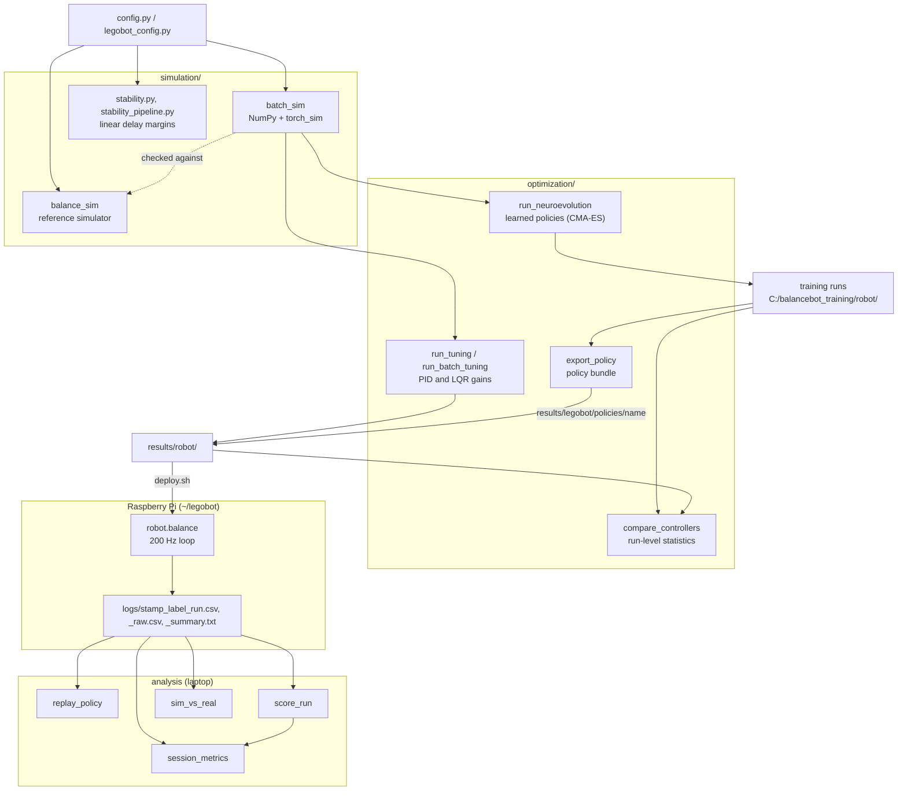

# Project Architecture: ML-Tuned Control of a Two-Wheeled Balancing Robot

Living document: how the repository is laid out and how its parts connect.
Last updated: 2026-11-26

See also:
- `README.md`: what to run, in order.
- `config.py` (project root): the single place to edit the robot, actuator model, sensor noise, delays, cost weights, search ranges and robustness test. `legobot_config.py` is the LEGO robot's version.
- `simulation/CONDITIONS.md`: the real-world effects the simulation includes.
- `PHYSICS.md`: every equation in the simulator, checked by `simulation/examples/physics_checks.py`.
- `BATCHED.md`: the batched (NumPy/GPU) engine. `LQR.md`: the LQR controller. `PIVOT.md`: the pivot side project.
- `DATASHEET.md` (Pololu reference build) and `hardware/legobot/DATASHEET.md` (LEGO robot).
- `hardware/legobot/SOFTWARE_PLAN.md`: the LEGO robot's software plan (phases A-E). `hardware/legobot/POLICY_ON_ROBOT_PLAN.md`: running learned policies on it (P1-P8).
- `simulation/balance_sim/STABILITY_PIPELINE.md`: delay margins with the LEGO sensor pipeline.
- `docs/ml-baselines-plan.md`: the learned-controller plan and results.

## Repository layout

Only tracked files are listed. Training runs and Pi logs live outside the repository (see "Data flow").

```
config.py              project config, robot selection, results_dir(), the Pololu robot (POLOLU_CONFIG)
legobot_config.py      the LEGO SPIKE robot's config (selected by --robot legobot / ROBOT=legobot)
pivot_config.py        the pivot side project (Pololu robot only)
pytest.ini             testpaths = simulation/tests optimization/tests
requirements.txt
simulation/
  balance_sim/         reference simulator, one robot at a time (pure Python)
  batch_sim/           batched simulator: NumPy, and PyTorch/CUDA in torch_sim.py
  pivot_sim/           the pivot side project's model
  examples/            demos and checks (run_demo, run_velocity_demo, run_pivot_demo, physics_checks, datasheet_numbers)
  animate.py           side-view animation of runs or of logged CSVs
  stability_pipeline_table.py   LEGO delay-margin table (L vs model-based PID)
  tests/
optimization/
  tuning/              reference tuner: SearchSpace, Evaluator, optimizers, reporting
  batch_tuning/        batched tuner: BatchEvaluator, vectorized DE, CMA-ES, PolicySearch, robust scoring
  pivot_tuning/
  run_tuning.py, run_batch_tuning.py, run_lqr_comparison.py, run_pivot_tuning.py
  run_neuroevolution.py, compare_controllers.py, export_policy.py
  benchmark.py, benchmark_batch.py, benchmark_policies.py, power.py
  tests/
hardware/legobot/      the physical LEGO robot
  robot/               code that runs on the Pi (plus laptop-only analysis tools)
  robot/measure/       bench measurement scripts and their fits (fit.py)
  bench_data/          recorded bench logs
  deploy.sh            copies the robot code and policy bundles to the Pi
  legobot_*.py, e1_*.py, e2_*.py, backlash_check.py, pwm_pulse_check.py   laptop-side derivations and experiment scripts
  *.md                 plans, datasheet, bench checks, experiment notes and preregistrations
results/
  pololu/<kind>/       Pololu results (batch_tuning, lqr_comparison, pivot_tuning, ...)
  legobot/<kind>/      LEGO results (batch_tuning, benchmarks, comparison, e1_ablations, e1_policy_dev_preview,
                       e2_selection, policies, reference_pid)
scripts/               slurm_neuroevolution.sh (cluster wrapper for run_neuroevolution.py)
docs/                  plans, reviews (docs/legobot-review/), slides and drafts
paper/                 methods draft, figures, results-planning notes
literature/            reference papers (PDF)
archive/               the original code and its results; CHANGES_FROM_ORIGINAL.md
```

## Data flow



1. **Config.** `config.py` holds every adjustable number and builds the objects the rest of the code uses (`RobotParams`, `Planar2D`, `EvalConfig`, `SearchSpace`, ...). The robot is chosen once at import: `--robot NAME`, else the `ROBOT` environment variable, else `pololu` (`load_config`, `add_robot_argument`). `legobot_config.py` is the LEGO robot. `results_dir(...)` gives `results/<robot>/<kind>`.
2. **Simulation.** At each control tick the sensor model turns the true state into a measurement, the controller turns it into a command, and the command reaches the actuator after the latency. Metrics turn a finished run into a cost (pitch, effort, velocity error, fall penalty).
3. **Tuning and training.**
   - `run_tuning.py` (reference engine) and `run_batch_tuning.py` (batched engine) search PID or LQR gains and write to `results/<robot>/`.
   - `run_neuroevolution.py` trains learned policies with CMA-ES. It writes to `<base>/<robot>/` (`ProjectConfig.training_output_root`): `<base>` is `$BALANCEBOT_TRAINING_DIR`, else `LearningConfig.output_dir` (`C:/balancebot_training`) if that drive exists, else `results/`.
   - `compare_controllers.py` compares controllers on fixed seed tiers.
4. **Export.** `optimization/export_policy.py` turns a training run (or a synthetic policy: `l_pid`, `a_warm_zero`, `b1_zero`) into a bundle in `results/<robot>/policies/<name>/`: `final.npz`, `snapshot.json`, `summary.json`, `manifest.json`, `golden.npz`, `envelope.json`. Committed LEGO bundles: `a_warm_zero`, `b1_zero`, `l_e2_s1`, `l_pid`.
5. **Deploy.** `bash hardware/legobot/deploy.sh [host]` (default `legopi`) copies `config.py`, `legobot_config.py`, `simulation/balance_sim`, `hardware/legobot/robot` (no tests) and `results/legobot/policies` to `~/legobot` on the Pi. It writes `~/legobot/DEPLOYED` with the commit (`-dirty` if the tree had changes) and the time.
6. **Run.** On the Pi, `robot/run_safe.sh robot.balance ...` runs the loop. It writes `logs/<stamp>_<label>{_run.csv,_raw.csv,_summary.txt}`.
7. **Analyze.** Logs are copied to the laptop by tools outside this repository. The analysis scripts in `hardware/legobot/robot/` read them (see "Analysis tools").

## Simulation

Three engines run the same model: `balance_sim` (reference), `batch_sim` (NumPy, bit-identical to the reference in float64) and `batch_sim/torch_sim.py` (GPU). A model change goes into all three. `test_equivalence.py` and `test_torch.py` check they agree.

| Module (`simulation/balance_sim/`) | Contents |
|---|---|
| `params.py`, `dynamics.py`, `planar2d.py` | `RobotParams`; the `Dynamics` interface; `Planar2D` (wheeled inverted pendulum), `linearize`, `critical_pitch_gain` |
| `actuators.py` | `IdealActuator`, `DCMotorActuator`, `VoltageModeActuator`, `SlowPwmActuator` (Build HAT slow PWM), `pdm_update` |
| `sensors.py` | `SensorNoise`, `IMUSensor`, `ComplementaryFilter`, `accelerometer_tilt`, `Encoder` |
| `controllers.py`, `pid_design.py`, `lqr.py` | `CascadedPIDController`, goal profiles (`step_profile`, `push_profile`); `model_based_pid_gains`; the LQR controller |
| `policy.py` | learned policies: `PolicySpec`, `PolicyController`, `FastPolicyController`, `compile_forward`, `save_policy` / `load_policy`, `pid_equivalent_weights` |
| `simulator.py`, `metrics.py`, `trajectory.py` | `simulate` (RK4, control-rate hold, latency); `cost`, `compute_metrics`; `save_trajectory` / `load_trajectory` |
| `stability.py` | exact stability of the sampled, delayed linear loop with ideal sensing (`LinearController`, `stable_latency_range`) |
| `stability_pipeline.py` | the same with the LEGO sensor pipeline (see below) |

`batch_sim/` mirrors this for many robots at once (`BatchRobot`, `simulate`, `policy.py`, `torch_sim.py`). `pivot_sim/` is the pivot side project's model.

### Stability analysis

- `stability.py` gives delay margins with ideal sensing: the controller sees the true state.
- `stability_pipeline.py` linearizes the LEGO loop as it is simulated and trained: complementary filter, delayed and differenced encoder, back-EMF feedforward and the Build HAT's 10 ms PDM. Main names: `Pipeline`, `Model`, `margin`, `margin_table`, `sensing_models`, `cruise_params`, `corner_params`. With every stage off it reproduces `stability.py`.
- `simulation/stability_pipeline_table.py` prints the margin table for L and the model-based PID under three sensing models (ideal, sim pipeline, hardware-like). Flags include `--phase-step`, `--imu-delay`, `--right-lag`, `--right-enc-age`, `--max-latency`, `--policy` and `--json`.
- Method and numbers: `simulation/balance_sim/STABILITY_PIPELINE.md`. Tests: `simulation/tests/test_stability_pipeline.py` (runs only with `ROBOT=legobot`; skipped otherwise).

## Optimization

| Path | Role |
|---|---|
| `tuning/` | `SearchSpace`, `Evaluator` / `EvalConfig`, differential evolution, random search, Bayesian optimization; `reporting.py` (tables, figures, `provenance`) |
| `batch_tuning/` | `BatchEvaluator`, vectorized DE, CMA-ES, `PolicySearch` / `cma_es_policy_search`; `robust.py` (`RobustnessConfig`: randomized robots, latency, chaos penalty) |
| `run_batch_tuning.py` | batched PID/LQR tuning; validation only with `--final` |
| `run_lqr_comparison.py` | PID vs LQR (Pololu robot) |
| `run_neuroevolution.py` | trains learned policies (`--method`, `--profile`, `--run-seed`, `--resume`) |
| `compare_controllers.py` | tiers, run-level statistics, latency sweep (`--tier`, `--policies`, `--latency-sweep`, `--final`, `--reference`) |
| `export_policy.py` | writes a policy bundle for the robot (`--name`, `--synthetic`, `--robot`, default `legobot`) |
| `power.py` | keeps long runs from being throttled by Windows; logs GPU power |

The LEGO robot has no LQR. Its reference PID is frozen in `results/legobot/reference_pid/comparison.json` by `hardware/legobot/e2_freeze_reference.py`.

## The LEGO robot (`hardware/legobot/`)

Hardware: 2 LEGO SPIKE Large Angular Motors, a Raspberry Pi 3B with a Build HAT, a SparkFun Auto pHAT (ICM-20948 IMU) and a 2S LiPo (`hardware/legobot/DATASHEET.md`).

### Robot code (`hardware/legobot/robot/`)

| Module | Role |
|---|---|
| `balance.py` | the balancing loop and its command line |
| `control.py` | hardware-free core, shared with the simulator: `Brain`, `PitchEstimator`, `Feedforward`, `Safety`, `LineClock`, `Pacer`, `CommandDelay`, `EnvelopeMonitor`, `load_policy_bundle`, `self_test_policy`, `build_controller` |
| `loop_config.py` | loop limits and constants (`TILT_LIMIT`, `VIN_CUTOFF`, `GOLDEN_TOL`, `MAX_ADDED_DELAY_S`, `POLICIES_DIR`, ...) |
| `hw_config.py`, `buildhat_serial.py`, `imu.py`, `battery.py` | ports and signs; the Build HAT serial driver (`BuildHat`); the IMU (`Imu`); battery voltage |
| `calibrate.py` | `balance` (pitch zero) and `signs`; writes `~/legobot/calibration.json` |
| `sim_hw.py` | simulated HAT, IMU and clock: `python -m robot.balance --sim` from `hardware/legobot` runs the real loop against the simulator |
| `run_safe.sh`, `kill9_test.sh` | run a script with the motors stopped on any exit; test that |
| `bench_log.py`, `duty_sweep.py`, `imu_axes.py`, `lock_sweep.py`, `probe_hat.py`, `measure/` | bench tools |

Controllers (`--controller`): `hand`, `model`, a gains JSON, a bundle path, or `policy:<name>` (a bundle in `~/legobot/policies`). A policy is checked against the deployed config and replayed against its golden vectors before it runs (`--allow-unchecked`, `--allow-config-mismatch` skip parts of this).

Each tick (200 Hz): read the IMU → complementary filter → newest motor data → safety checks → controller → feedforward duty per wheel → one serial command for both motors. The tick can be locked to the HAT's data lines (`LineClock`, `Pacer`; `--no-line-lock` uses the Pi's clock).

**Added delay (E3 Block D).** `--added-delay-ms N` puts a FIFO (`control.CommandDelay`) between the controller and the HAT write. N must be a whole number of 5 ms ticks, at most `loop_config.MAX_ADDED_DELAY_S` (50 ms); `control.added_delay_ticks` checks it. The FIFO delays the final duty, at the same point as the simulator's latency, so the controller's own state keeps what it issued. Safety trips bypass it. `_raw.csv` logs `duty_left/right` (written) and `issued_left/right` (computed). This is committed but not yet deployed to the Pi.

### Analysis tools (laptop)

| Script | Role |
|---|---|
| `replay_policy.py` | P4b: re-runs a logged policy run tick by tick through a fresh `PolicyController` and checks the logged torques |
| `score_run.py` | P8: scores runs with the simulator's cost; `--run-sheet` writes counterbalanced run sheets |
| `sim_vs_real.py` | overlays the nominal simulator on a logged policy run: `--mode resync` (re-started from the logged state every `--resync` s) or `--mode free` |
| `session_metrics.py` | the E3 preregistered metrics and hypothesis checks (`--block A|B|C`); uses `score_run` for cost and falls |

`sim_vs_real.py` and `session_metrics.py` default to folders on Evan's laptop (`C:\balancebot_training\legobot\pi_logs`, `C:\balancebot\reports\sim_vs_real`).

### Laptop-side scripts (`hardware/legobot/`)

- `legobot_scenario.py` derives the LEGO test scenario (`--check` reproduces config's numbers). `legobot_baselines.py`, `legobot_numbers.py`, `legobot_learning_scales.py` give baselines, derived numbers and learning scales.
- `e1_*.py`: Phase E1 tuning, ablations and provenance (`hardware/legobot/E1_NOTES.md`).
- `e2_select.py` (E2.2 policy selection), `e2_freeze_reference.py` (E2.3), `e2_gate_b.py` (E2.4): see `hardware/legobot/E2_PLAN.md`.
- `backlash_check.py`, `pwm_pulse_check.py`: checks of the backlash and PWM models.

## Two robots and the LEGO models

**Robot selection.** `POLOLU_CONFIG` is config.py's defaults. `legobot_config.py` is the LEGO build. `ProjectConfig.name` is saved in every snapshot. The pivot side project always uses the Pololu robot. The tests run under either robot (`ROBOT=legobot`); tests that check Pololu numbers carry a `pololu_only` skip.

**Models added for the LEGO robot (SOFTWARE_PLAN Phase B).** Each is in all three engines, selectable in config, and used by the LEGO robot only. The Pololu robot keeps its earlier models. Derivations: PHYSICS.md.

| Step | Component | Where |
|---|---|---|
| B1 | Voltage-mode driver with back-EMF feedforward | `VoltageModeActuator`; `ActuatorConfig.model = "voltage"` |
| B1b | Build HAT slow PWM, applied by pulse-density modulation | `SlowPwmActuator`, `pdm_update`; `ActuatorConfig.model = "slow_pwm"` |
| B2 | IMU and the robot code's complementary filter | `IMUSensor`, `ComplementaryFilter`, `accelerometer_tilt`; `SensorConfig.model = "imu"` |
| B3 | Encoder as the Build HAT reports it | `Encoder`; `SensorConfig.encoder_counts`, `encoder_period_s`, `encoder_delay_s` |
| B4 | Motor L/R folded into the latency, not modeled | PHYSICS.md 10.3 |
| B5 | Gearbox and coupling backlash | `RobotConfig.gearbox_backlash`, `coupling_backlash` |
| B6 | Pitch offset drawn per scenario | `BatchRobot.pitch_bias`; `randomize_range` entry `("pitch_bias", ...)` in legobot_config.py |

Tests for these: `test_voltage_mode.py`, `test_slow_pwm.py`, `test_imu.py`, `test_encoder.py`, `test_backlash.py` in `simulation/tests/`.

## Entry points

Run from the project root unless noted. For the LEGO robot set `ROBOT=legobot`; scripts that call `add_robot_argument` also take `--robot legobot`.

| Command | What it does |
|---|---|
| `python simulation/examples/run_demo.py` | an ideal and a harder simulated run, with metrics and plots |
| `python optimization/run_batch_tuning.py` | batched PID tuning |
| `python optimization/run_neuroevolution.py` | train a learned policy |
| `python optimization/compare_controllers.py` | compare controllers |
| `python optimization/export_policy.py <run folder> --name <name>` | export a policy bundle |
| `python simulation/stability_pipeline_table.py` | LEGO delay-margin table |
| `python simulation/animate.py --csv <file>` | replay a logged or saved run |
| `bash hardware/legobot/deploy.sh [host]` | copy the robot code and bundles to the Pi |
| `robot/run_safe.sh robot.balance --controller policy:<name> --seconds 20` | on the Pi, from `~/legobot` |
| `python -m robot.balance --sim` | from `hardware/legobot`: the loop against the simulator |
| `python -m robot.replay_policy logs/<stamp>_<label>` | from `hardware/legobot` |
| `python -m robot.score_run logs/*_run.csv` | from `hardware/legobot` |
| `python hardware/legobot/robot/sim_vs_real.py <stamp or _run.csv> --mode resync` | sim-vs-real overlay |
| `python hardware/legobot/robot/session_metrics.py --block A` | E3 session metrics |

## Tests

- `python -m pytest` runs `simulation/tests` and `optimization/tests` (pytest.ini): about 750 tests under the Pololu robot, a few more with `ROBOT=legobot`.
- The robot code's tests are separate: `python -m pytest hardware/legobot/robot` (about 130 tests: `test_control.py`, `test_added_delay.py`, `test_session_metrics.py`, `test_sim_vs_real.py`, `measure/test_fit.py`).
- Use the project venv and hide the GPU for CPU-only runs; see `CLAUDE.md`.

## Not built

- 3D / PyBullet model to validate the 2D assumptions.
- Deep reinforcement learning (PPO, residual PPO): docs/ml-baselines-plan.md section 6.

## Change log

- 2026-09-18: Initial version. All components planned.
- 2026-09-18: Simulation core built and tested (params, dynamics interface, Planar2D, PID, simulator loop, metrics). Added Planar2D.critical_pitch_gain(), the analytic lower bound on Kp, for use as a tuner search bound.
- 2026-09-18: Added sensor noise, control latency, and a DC motor model. Added CONDITIONS.md to track real-world effects. Tests now 25.
- 2026-09-19: Added cascaded velocity/pitch controller, goal velocity profiles, and a velocity error term in the cost function. Tests now 38.
- 2026-09-21: Built the first tuner (optimization/tuning): search space, multi-scenario evaluator, differential evolution, random-search baseline, validation on unseen seeds, and result logging. Sped up the simulation core about 2.5x (plain-float math in the hot path) so tuning runs finish in minutes. Tuner tests: 14.
- 2026-09-24: Added config.py at the project root as the single source of truth for physical parameters, actuator model, sensor noise, timing, cost weights, and search bounds; the demos and the tuner now all build from it instead of each holding their own copies of these values (this fixed a couple of small inconsistencies, like two different demo scripts using two different latency values). Added Bayesian optimization (scikit-optimize) as a second search method alongside differential evolution. Tuner + config tests: 23.
- 2026-09-28: Every tuning run now records a full snapshot of config.py (all robot parameters, actuator and sensor settings, timing, limits, cost weights, scenario, search bounds, plus derived values) in comparison.json and in each method's own result file, along with the run arguments and a timestamp. Tests: 25.
- 2026-09-28: Created CPU/, a corrected copy of simulation/, optimization/, and config.py that serves as the reference for the GPU rewrite (originals untouched; details in CPU/README.md). Fixes: the DC motor now respects max_torque; both controller loops have anti-windup; the cost's pitch term is measured against the commanded lean (switchable back to upright); every start tilt is tried with every seed (9 training runs, 30 validation); run_tuning.py adds an equal-budget comparison and bound warnings for every method; one requirements.txt; added optimization/benchmark.py. Tests: 86.
- 2026-09-28: Built the batched engine (then GPU/): batch_sim steps many robots at once with NumPy or PyTorch on the GPU (CUDA graphs), matching the reference simulator exactly in float64 on NumPy; batch_tuning adds a batched evaluator, vectorized differential evolution, and CMA-ES; robust scoring adds 50 seeds, randomized robots, and a chaos penalty. Up to about 5,800x faster per simulation than the reference on the GPU.
- 2026-09-28: Cleanup. The corrected code (CPU/) is now the project's only simulation/, optimization/ and config.py, with the batched engine alongside it (simulation/batch_sim, optimization/batch_tuning, run_batch_tuning.py, benchmark_batch.py). The robustness settings moved into config.py. One pytest.ini, one requirements.txt, one results/ (tuning/, batch_tuning/, benchmarks/). The original code and its results moved to archive/original/. Added README.md describing the run order. Tests: 153.
- 2026-09-28: Every project value now lives only in config.py: RobotParams, MotorParams, EvalConfig, SimSpec, BatchRobot, cost() and the search space lost their duplicate defaults, SensorNoise.typical() was removed, and the controllers' integral limits (previously hardcoded in two places) moved into ControllerConfig. The tests build from CONFIG. Dropped kv_i: the project's gain set is [kp, ki, kd, kv_p] (the controllers and both simulators still accept a fifth gain). The two tuning scripts share their results table, bound check and summary figure (tuning/reporting.py, SearchSpace.at_bounds), and the batched evaluator's noise_for / simulations_per_evaluation are public. The hand-tuned baseline without kv_i scores 0.243 (reference validation) instead of 0.277; the tuned optimum is unchanged at 0.108. Tests: 166.
- 2026-09-30: Added simulation/animate.py, an optional viewer: an animated side view of one or more runs (wheel, body, center of mass, commanded lean) with pitch / velocity / torque plots, saved as GIF or MP4 if wanted. Runs are simulated with the reference simulator first and then played back, or replayed from trajectory CSVs (balance_sim.save_trajectory / load_trajectory). Both tuning scripts now save their example runs to <results>/trajectories/. Tests: 172.
- 2026-10-14: Added an LQR controller to the base robot (simulation/balance_sim/lqr.py): full-state feedback designed on the linearized model (`Planar2D.linearize`), discretized at the control rate with the latency built in exactly (the commands in flight become part of the state). It runs in the reference simulator and in batch_sim (NumPy and GPU, bit-identical to the reference in float64 on NumPy). `balance_sim/stability.py` gives the exact stability of the sampled, delayed linear loop for either controller, and so every controller's delay margin. The tuners can search LQR weights or LQR gains (`LQRConfig` in config.py; `BatchEvaluator(controller="lqr", to_gains=...)`), and `optimization/run_lqr_comparison.py` compares hand-tuned and ML-tuned PID with four LQR variants on one common score. Design, results and findings: LQR.md. Tests: 262.
- 2026-10-24: The cost weights are now derived by Bryson's rule from three acceptable-value limits in `CostConfig` (`pitch_limit_rad` 0.3, `velocity_limit` 0.2 m/s, `torque_limit` 0.1 N m), giving velocity 2.25 and effort 9 (were 1 and 0.01). The cost now scores pitch from upright by default (was the commanded lean), and `fall_penalty` is 500 (was 100): at the new weights a slow, wandering controller that never falls can cost ~190, which beat the cheapest fall. The pivot side project keeps the old cost (`PIVOT_BASE_COST` in `pivot_config.py`). The weights are properties of `CostConfig` and the snapshot records both limits and weights. `physics_checks.py` follows `pitch_reference`. Tests: 268 (four LQR/pivot/torch/config tests changed or added; a test already failing before the change was fixed). Existing results in `results/` and the numbers in PHYSICS.md 8.2, LQR.md and BATCHED.md's cost figures were produced with the old cost and are not comparable; a re-run is pending.
- 2026-10-24 (later): `kv_p_max` raised from 0.4 to 0.8, which the tuned results had all sat on. Re-ran `run_batch_tuning.py` (`results/pololu/batch_tuning/20261024-133625`: CMA-ES 0.1305 robust validation cost, kv_p 0.800) and `run_lqr_comparison.py` (`results/pololu/lqr_comparison/20261024-135209`; the ML-tuned LQR gains are within 2.6% of the ML-tuned PID, and the untuned cost-matched LQR is 3x worse). A run with the bound at 2.0 (`results/pololu/batch_tuning/20261024-135453`) put kv_p at 0.82 for the same cost, so 0.8 stays. Two of the LQR searches ended at their range edges; see LQR.md. The pivot's search space reads the same bound, so its recorded results are unchanged but a re-run would differ.
- 2026-10-24 (later still): `kv_p_max` set to 0.9 so the settled value (about 0.82) is inside the bound. Widened the LQR search ranges (`w_velocity` floor 1e-2 to 1e-4, `w_integral` ceiling 10 to 1e3, `direct_gain_scale` 20 to 100) and re-ran `run_lqr_comparison.py` (`results/pololu/lqr_comparison/20261024-140819`): the tuned PID 0.1304, the tuned LQR gains 0.1334 (2.3% behind), the tuned LQR weights 0.1857. The LQR weight search now ends in a corner (floor for `w_velocity`, ceiling for `w_torque`) and the gain search keeps the command-feedback scales at their floor, which looks like a limit of those parameterizations rather than of the ranges (LQR.md).
- 2026-10-24 (last): the LQR pitch-rate weight and the gains on the commands in flight are held at off instead of searched (`LQRConfig.w_pitch_rate_fixed`, `direct_commands_scale`; `None` searches them as before; `lqr_weight_space`, `lqr_weights`, `LQRWeightDesigner`, `lqr_gain_space` and `LQRGainScaling` take the matching `fixed` / `commands_scale` arguments). Both searches had been driving them to the floor of their log ranges. Re-ran `run_lqr_comparison.py` (`results/pololu/lqr_comparison/20261024-142418`): the tuned LQR gains 0.1333 (unchanged, now with interior scales), the tuned LQR weights 0.1857 (unchanged, still in a corner at `w_velocity` and `w_torque`). Tests: 271.
- 2026-11-06: friction and latency randomization (PHYSICS.md 10.1). Both engines model viscous plus smoothed Coulomb friction (`RobotConfig.coulomb_friction`, `coulomb_friction_speed`). Per-simulation latency: `simulate_batch(delay_steps=...)` and `TorchSimulator(max_delay_steps=...)`. `RobustnessSettings.randomize_range` and `latency_range_s` draw friction and a 5-20 ms latency per scenario. The LQR weight search is torque-normalized, with the pitch, velocity and pitch-rate weights held at 0 (the corner was the pitch-weight normalization; LQR.md). The pivot uses config.py's cost (`PIVOT_BASE_COST` removed).
  - Guards: `control_dt` must be a whole multiple of `dt`; train and validation seeds may not overlap; results JSONs record git commit and library versions (`tuning.provenance`); a test checks the fall-penalty headroom.
  - Re-runs: `results/pololu/lqr_comparison/20261106-154350` (tuned PID 0.169, tuned LQR gains 0.199, tuned weights 0.241), `results/pololu/batch_tuning/20261106-154750` (same PID gains), `results/pololu/pivot_tuning/20261106-154343`.
  - Tests: 297.
- 2026-11-06 (later): `physics_checks.py`'s `TUNED` is now the 2026-11-06 set (`TUNED_0930` keeps the old one for 8.2 and 9.4), and PHYSICS.md quotes it throughout. The search's Kp floor comes from the most demanding randomized robot (`ProjectConfig.kp_floor_robot`; 0.300 instead of 0.253, still far below the tuned 0.66, so the recorded results stand). The batched engines apply the gyro bias without a noise table, as `SensorNoise` does with every std at 0. Tests: 301.
- 2026-11-08: Realistic physical constants (DATASHEET.md: a reference build of real parts, compared constant by constant). Both engines and the pivot model now include the motor rotors' reflected inertia in the mass matrix (`RobotParams.rotor_inertia`, PHYSICS.md 10.3), a gearbox efficiency in the DC motor model (`MotorParams.gear_efficiency`) and a constant pitch-estimate offset (`SensorNoise.pitch_bias`). config.py takes the Pololu 25D HP 6V 20.4:1 motor's constants (k_t 0.0053, 1.25 ohm with the driver, 7.6 V, efficiency 0.78), the real wheels (0.034 kg, 2.2e-5 kg m^2), body inertia 0.0065, max torque 0.34 N m, and friction ranges from the free-run current. With all of these off the code reproduces the previous results exactly (physics_checks.py output unchanged). The 2026-11-06 tuned gains are not tuned for this robot (validation cost 0.14 before, about 55 with 1 of 30 falls now); every results/ run predates it. PHYSICS.md's numbers and physics_checks.py stay on the earlier robot until regenerated after retuning.
- 2026-11-08 (later): Retuned on the datasheet robot (GPU, same arguments as 2026-11-06). `results/pololu/batch_tuning/20261108-132528`: CMA-ES and DE agree on kp 1.567, ki 2.101, kd 0.285, kv_p 0.645 (nominal validation 0.255, robust validation 0.583, no falls in 300 unseen robots, stable to 40.5 ms). `results/pololu/lqr_comparison/20261108-133118`: the PID still wins; tuned LQR gains 1.18x, tuned weights 1.39x, cost-matched LQR 3.7x. `results/pololu/pivot_tuning/20261108-132603`: same findings as before (the pivot still doesn't pay). physics_checks.py now runs on the current robot with rotor inertia and gear efficiency in its closed forms, and PHYSICS.md is regenerated from it (rotor inertia derived in 2.2; unstable pole 8.44 rad/s; the 2026-11-06 gains are linearly unstable here at any latency; a voltage-mode driver capped at the torque limit uses only 2.5 V of 7.6 V and every gain set falls). LQR.md and PIVOT.md quote the re-runs. Tests: 310.
- 2026-11-08 (scenario redesign): The test scenario is redesigned so every element is tied to a test objective and sized from a robot limit (`ScenarioConfig` docstring): start tilts 0.05, -0.15 and 0.30 rad, a 1.6 s speed-up to a 1.3 m/s cruise, forward and backward 2.9 N x 50 ms pushes at the body's center of mass, braking and reversing to -0.5 m/s, a stop; 20 s training runs and 60 s validation runs (the last goal held, so slow instabilities show). Both engines take an external force (`Planar2D.derivatives(..., force)`, `SimSpec.disturbance`); `step_profile` takes a blend time per change; `fall_penalty` 500 -> 1000 (the non-fall bound for 20 s runs is 883). Retuned: `results/pololu/batch_tuning/20261108-153813` (CMA-ES kp 1.635, ki 1.766, kd 0.299, kv_p 0.620; robust validation 2.26, no falls; hand-tuned 30.0 with 2 falls, both from the forward push at top speed). `results/pololu/lqr_comparison/20261108-182234`: the PID still wins (tuned LQR gains 1.35x; the weight-tuned and cost-matched LQRs fall on 7 and 2 of 300 robots). physics_checks.py uses the new gains and goal-change times, and PHYSICS.md, LQR.md, README.md and BATCHED.md are updated from it; PIVOT.md flags that the pivot results predate the new scenario. robot.gif re-saved from the new run. Tests: 325.
- 2026-11-08 (model-based baseline): `balance_sim/pid_design.py` designs the cascaded PID from the linear model alone, by the textbook sequential method (inner pitch poles placed: a critically damped pair at twice the unstable pole plus a slow integral pole; outer bandwidth a third of the RHP zero; `ControllerConfig.design_*`, `ProjectConfig.model_based_gains`; PHYSICS.md 6.5). Gains kp 1.729, ki 2.012, kd 0.148, kv_p 0.314, linearly stable to 23.75 ms. It is a baseline in `run_batch_tuning.py` and `run_lqr_comparison.py`: `results/pololu/lqr_comparison/20261108-220417` (other rows identical to 20261108-182234) gives it a median per-scenario cost 1.36x the ML-tuned PID's but 2 falls in 300 robots. `animate.py` now labels the scenario phase and draws pushes as arrows on the robot and markers on the plots; robot.gif shows the ML-tuned against the model-based PID from the 0.30 rad start tilt. Tests: 329.
- 2026-11-09 (fresh validation set, methods review): An adversarial review found that the robust validation set (seeds 1000-1099 and their robots) had been used while sizing the 20 s scenario's push and blend times. `RobustnessSettings.validation_seeds` is now 2000-2099, fixed after the scenario, search bounds and model-based design were frozen, and used for nothing else. `results/pololu/lqr_comparison/20261108-225341` re-validates every controller on it (searches unchanged): ML-tuned PID 2.22 with no falls; model-based PID median 1.36x with 1 fall; tuned LQR gains 1.34x with no falls; hand-tuned 6.2x with 4 falls. The conclusions are unchanged. Earlier results folders keep their old validation numbers.
- 2026-11-09 (learned controllers, Phase 0): the infrastructure of docs/ml-baselines-plan.md, for benchmarking learned controllers against the ML-tuned PID. `balance_sim/policy.py` is a policy controller (the measured state, the goal, two leaky integrators frozen while saturated, the last 4 commands; a hard-clipped output) in three shapes, linear (10 weights), MLP (481) and both (492), plus a residual on the reference PID (513; zero output is the PID bit for bit). `batch_sim` runs many different networks at once (NumPy bit-identical to the reference in float64; GPU within 2e-15 with batched matrix products), `BatchEvaluator.evaluate_policies` scores them, and `PolicySearch` / `cma_es_policy_search` search them, resumably. Seed tiers (smoke, dev, frozen validation and fall-rate) in `RobustnessSettings`. The gate test passes: the linear policy with the PID-equivalent weights is within 1% of the reference PID (+0.68% training, -0.66% 60 s dev). `stability.LinearController` takes several leaky integrators, so the linear policy's margin is exact (PID-equivalent: 0 to 37.25 ms, same as the PID). `optimization/run_neuroevolution.py` trains (checkpoints, float64 dev scores, run profiles, resume, SLURM wrapper in scripts/), `compare_controllers.py` compares (run-level bootstrap, order-statistic intervals, Clopper-Pearson, McNemar, latency sweep), `benchmark_policies.py` times a generation (L 3.4 s; an A-sized MLP at population 1,332, 16.4 s; B1 21 s; the GPU forward pass uses batched matrix products, NumPy keeps the fixed-order loop). Nothing trained yet. Tests: 394.
- 2026-11-09 (first learned-controller results): training runs write to `C:/balancebot_training` (`LearningConfig.output_dir`, or `$BALANCEBOT_TRAINING_DIR`), outside the synced folder. `optimization/power.py` keeps a run from looking idle to Windows (no sleep, no screen-off, no EcoQoS throttling for the process) and logs each generation's time, GPU power limit and G-Helper mode. Both batch engines count torque roughness, saturated ticks and peak pitch outside the cost, and `compare_controllers.py` reports them with a weight-sensitivity re-scoring (each Bryson limit halved and doubled, effort off, the motors' thermal torque limit). First full run of the linear policy L: on dev it beats the ML-tuned PID (median ratio 0.870, no falls, ahead under all 9 weightings, the smoothest torque of any controller) with a smaller linear delay margin (28 ms against 37.25 ms); docs/ml-baselines-plan.md has the numbers and the follow-up (section 12.1). Tests: 397.
- 2026-11-09 (latency range and LQR integral gain): Robust scoring draws latency from 2.5-20 ms (was 5-20, which missed the 1.7-5.6 ms hardware estimate). The direct LQR gain search also searches an integral gain (`LQRConfig.direct_integral_bounds`, log scale 1e-3 to 10), and `tuning.LQRGainScaling` requires a candidate with integral action to keep the nominal spectral radius below `direct_max_spectral_radius` (0.999), which rules out the slow runaway an unguarded integral search once found; the pull-back keeps the candidate's integral gain when that is acceptable on its own. Validation moved to a third held-out set (seeds 3000-3099), since results on 2000-2099 had been seen. Re-tuned: `results/pololu/batch_tuning/20261108-234630` (kp 1.615, ki 1.746, kd 0.298, kv_p 0.626). `results/pololu/lqr_comparison/20261109-000021`: the directly tuned LQR, now with integral action, is 9% behind the ML-tuned PID (34% without); model-based PID 1.34x with no falls on this set; hand-tuned 5.8x. physics_checks.py and PHYSICS.md stay on the 20261108-153813 gains (within 1.2%). Tests: 330.
- 2026-11-22: Two robots, and the LEGO robot's models (SOFTWARE_PLAN Phase B). `--robot` / `ROBOT` select `pololu` (config.py's defaults, unchanged) or `legobot` (legobot_config.py, from hardware/legobot/DATASHEET.md); LEGO results go to `results/legobot/`. All three engines gained a voltage-mode driver with back-EMF feedforward (B1), an IMU with the robot code's complementary filter (B2), an encoder with counts, period and transit delay (B3), and a pitch offset drawn per scenario (B6); B4 (motor L/R) is folded into the latency. The Pololu robot keeps its earlier models, so its results are unchanged. New tests: test_voltage_mode.py, test_imu.py, test_encoder.py. PHYSICS.md 5.4, 5.5, 9.3, 9.5 and 10 document them; baselines are in hardware/legobot/A4_BASELINES.md.
- 2026-11-23 (PR #10 review fixes): an adversarial code review of the learned-controller work (Fable 5.2) found no bug in the simulators, the evaluator or the statistics as implemented, and confirmed L's dev result in the one-robot reference; its findings were about meaning and drift. Fixed: `reference_pid_file` points at the re-tuned PID (`results/pololu/lqr_comparison/20261109-000021`; gate re-measured, +0.63% / -0.68%); the duplicate `validation_seeds` is gone and 2000-2099 are retired; `run_lqr_comparison.py` and `run_batch_tuning.py` score validation only with `--final` (dev otherwise); `compare_controllers.py` adds a cost-based latency-sweep metric with a 10 ms baseline (a controller past its delay margin can oscillate without falling: L does, from about 25 ms), a paired method-against-method interval, a per-weighting fall-ordering check and per-run config warnings, and labels the order-statistic interval conditional on the scenarios; `run_neuroevolution.py` scores each checkpoint at the last generation not past its mark, charges A-warm's L budget in its cap and marks, refuses to resume under a changed config (`ProjectConfig.scoring_differences`), and logs the median step size. A float32 GPU run resumed in a new process matches an uninterrupted one exactly. The recorded L run predates the latency change and stays a development result. Tests: 582 (with the LEGO robot's, merged from main).
- 2026-11-23 (robots' results separated): every robot has its own results tree. `config.results_dir` now always gives `results/<robot>/<kind>`; the Pololu robot's results moved from `results/<kind>` to `results/pololu/<kind>` (git mv; the pivot side project's too, as it builds on the Pololu robot), and every text reference in the code and docs was rewritten. Training runs write to `<training folder>/<robot>/` (`training_output_root`), and the existing local runs moved to `C:/balancebot_training/pololu/`. Word and PowerPoint files (paper/methods.docx, docs/*.docx and *.pptx) were not edited and may still cite the old paths. Tests: 583.
- 2026-11-23 (learned controllers on the LEGO robot, before E1): `legobot_config.LEARNING` gives the LEGO robot its own observation and output scales, measured from its closed loop (hand-tuned PID and its PID-equivalent linear policy, the LEGO models, 150 dev runs of 60 s); velocity error and torque use 99th percentiles where the Bryson limits don't fit this robot. `LearningConfig.reference_pid_file` may be None: the reference is then the robot's own hand-tuned PID, flagged by `ProjectConfig.reference_is_provisional` in compare_controllers.py (which compares against the robot's hand-tuned and model-based PIDs) and run snapshots; `config.read_pid_comparison` reads run_batch_tuning.py's comparison.json as well as run_lqr_comparison.py's, for when E2 gives the LEGO robot a tuned reference. On the LEGO robot: L-PID is within 1% of the hand-tuned PID where both stay up (+0.63% training, -0.99% dev; their few falls differ, so the plain gate is unreadable until a reference that never falls), a generation takes 4.2 s (L), 17.1 s (MLP) and 18.2 s (B1), and a quick L run works end to end. Details: docs/ml-baselines-plan.md section 13. Tests: 587.
- 2026-11-26 (documentation): this file rewritten to match the repository after the LEGO robot work: the layout, the data flow from simulation to the Pi and back, the robot code (`hardware/legobot/robot/`), policy bundles (`export_policy.py`, `deploy.sh`), the stability pipeline (`stability_pipeline.py`, `stability_pipeline_table.py`), the added-delay FIFO (`--added-delay-ms`, not yet deployed) and the analysis tools (`replay_policy`, `score_run`, `sim_vs_real`, `session_metrics`). The component-status table was replaced by the module tables above. Earlier entries are kept as they were written; their paths and test counts are those of their date. Tests: 749 (`python -m pytest`; 757 with `ROBOT=legobot`), plus 131 in `hardware/legobot/robot`.
